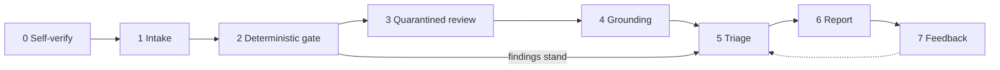
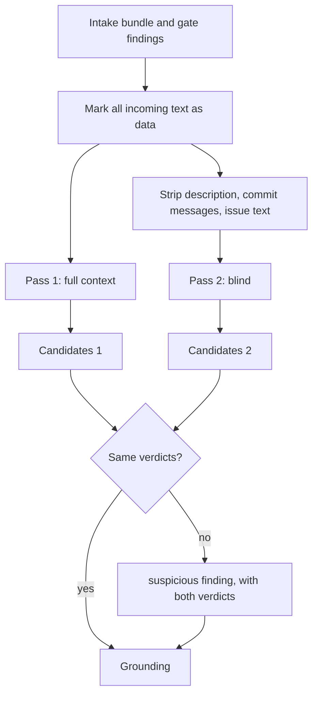
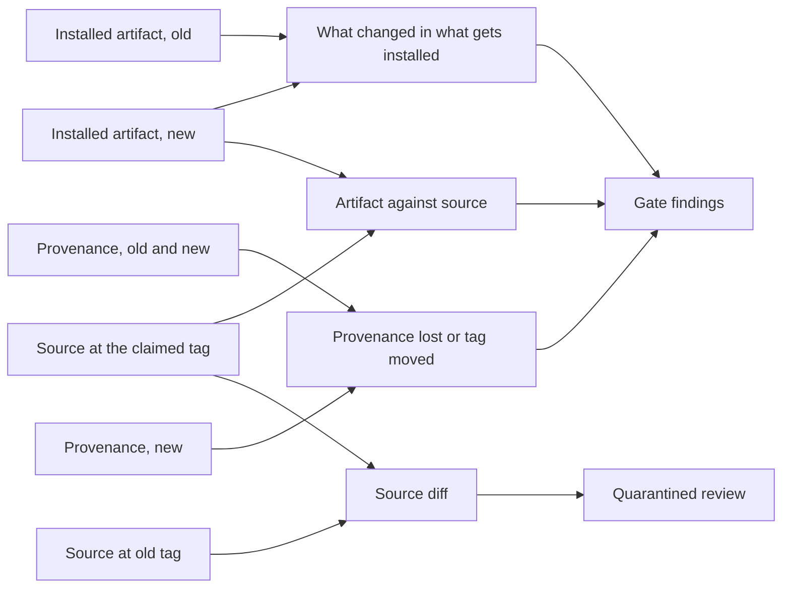
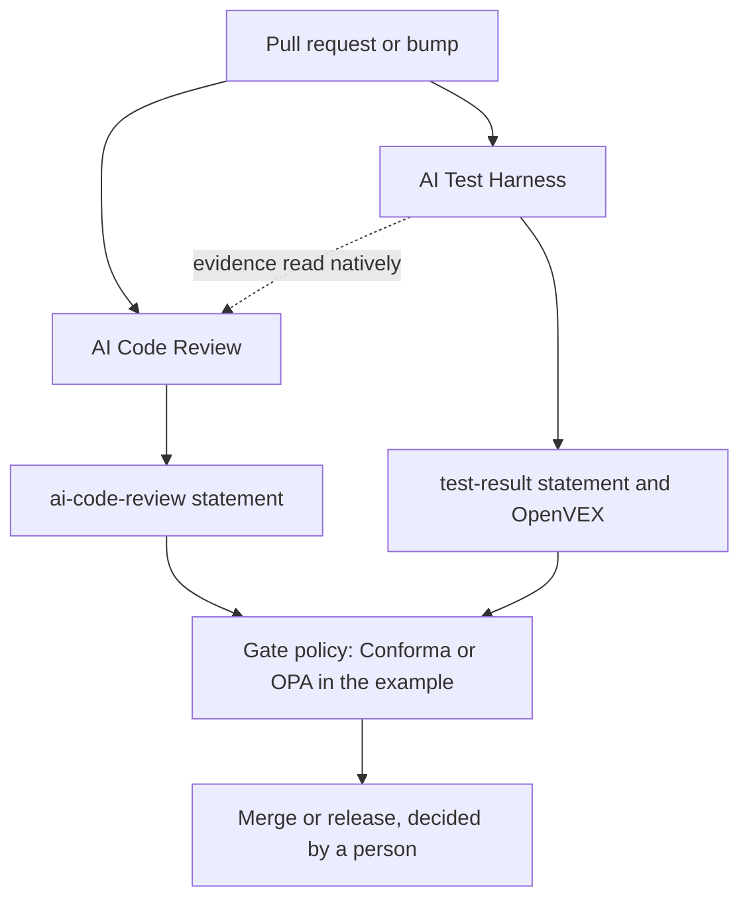

# How it works

**For:** engineers, architects and technical leaders who want the mechanism before the detail. Twenty
minutes. The [blueprint](03-blueprint.md) is the plan in three pages; the
[specification](14-specification.md) is what an implementation must do.

## The shape of it

Every change goes through the same eight stages, whatever its source. Each stage writes the records the
next one reads, so a run can be audited stage by stage after the fact.



The arrow from stage 2 straight to triage is the point of the design. The deterministic checks'
findings go to the report whatever the model says (decision D4). The model's findings take the long way
round, through grounding, and anything it cannot ground is dropped. Feedback tunes triage: a finding
category that developers leave unacted on is switched off (D2).

What intake gathers depends on where the change came from. Everything after intake is the same.

| Source | What intake gathers |
|---|---|
| Our own pull request or commit | The diff at the head commit, the base commit, the description, the linked issue, commit messages, the repository's conventions files, and the test harness's evidence for the same head commit |
| Agent-written change | The same, plus attribution records where the agent left them (Agent Trace, git-ai, commit trailers) |
| Dependency bump | The installed artifact at the old and the new version, the source at the tag each claims, their provenance and signatures, registry metadata (age, maintainers, install scripts), and the upstream source diff |
| Vendored, forked or generated code | The vendored tree and the upstream it names at the stated version, or the generator and its inputs, so the residue can be computed |

## A pull request, from draft to merge

The author sees the findings first (D14). The human reviewer arrives later, to a short spotlight and the
checked list, not to a list of AI comments to confirm.

```mermaid
sequenceDiagram
    participant A as Author
    participant F as Forge
    participant R as Reviewer pipeline
    participant H as Human reviewer
    participant G as Merge gate
    A->>F: Opens a draft pull request
    F->>R: Event: draft opened or pushed
    R->>F: Findings as comments, check concludes neutral
    A->>F: Fixes, answers or dismisses with a reason; pushes
    F->>R: Event: pushed
    R->>F: New run on the new head; resolved findings close
    A->>F: Marks ready for review
    F->>H: Review requested
    R->>F: Spotlight and checked list for the reviewer
    H->>F: Approves or asks for changes
    F->>G: Merge requested
    G->>G: Reads the reviewer's statement and the harness's evidence for the head commit
    G->>F: Allows or holds the merge under the team's policy
```

Three rules hold across the sequence:

1. **Every push is a new run.** The signed statement names the head commit it reviewed. The gate rejects
   a statement for any other commit (G5).
2. **The reviewer comments; it never approves.** It posts COMMENT reviews only. The check concludes
   `neutral` for advisory findings and `failure` only when the team's policy holds the merge (D1, D13).
3. **A dismissal needs a reason.** It is recorded as a SARIF suppression with its justification, and
   feedback counts it as answered, not ignored (D3).

Where the forge has no draft state, findings start collapsed for reviewers.

## Inside the quarantined review

The model is the least trusted part of the system, because the text it reads is written by whoever
wrote the change. It runs with no tools, no shell, no network beyond the model endpoint, no forge token
and no signing key (D7). It cannot act, so a prompt injection can at worst produce a wrong candidate
finding, and grounding and the blind pass are there to catch that.



The blind pass keeps code comments, because Thornton found that stripping them hurt weaker models. That
leaves comment-borne attacks such as ALIBI's adversarial comments to grounding and the deterministic
gate, which do not read comments as instructions.

Each pass answers the four questions and returns structured candidates, validated against the
[finding schema](../blueprint/finding.schema.json). A candidate must name a rule from the fixed
[catalogue](../blueprint/rule-catalogue.yaml), a file and line, and its reasoning. Grounding then checks
each one:

- the file and line exist at the head commit, and the quoted span matches what is there;
- the rule is in the catalogue and fits the class;
- a claim a tool can check is checked by the tool;
- a claim only a test can settle becomes a test request to the harness, and the finding is shown as
  `unproven` until the harness answers.

A candidate that fails grounding is dropped and counted in the run's record. It is never shown.

## A dependency bump: the artifact first

Twelve of the 21 real malicious changes in the research put nothing malicious in the source diff (D6).
So for a bump, the source diff is the last of three objects the reviewer examines, not the first.



- **What changed in what gets installed:** new files, new install scripts, new dependencies and whether
  anything imports them, new capabilities such as network or process execution (malcontent, OSSGadget
  and Capslock in the example).
- **Artifact against source:** every difference between the package and the source at its tag is
  explained, as build output that regenerates, or it is a finding. An OSS Rebuild attestation counts as
  evidence where one exists.
- **Provenance:** a signature or attestation the previous release had and this one lacks is a finding.
  So is a tag that now points somewhere other than where it pointed when first seen.
- **The source diff** then goes through the quarantined review like a first-party change, for intent and
  defects.

Vendored and generated code use the same idea. Subtract what upstream or the generator explains, and
review only the residue. Generated code that does not regenerate to the same bytes is a finding.

## What the report looks like

The author's view opens with what was checked, then the findings. The reviewer's view adds the spotlight.
Neither ever says "approved", "safe" or "no issues" (D9). An illustration, not real output:

```text
AI Code Review (machine-generated; informs the review, is not one)

Checked: intent against diff; Unicode; secrets; licence; SAST on changed lines (bandit, Opengrep);
  new dependencies; CI wiring; harness evidence for a1b2c3d (12 tests, 1 advisory proven fixed)
Not checked: performance; generated/ (regenerated, no residue); 1 file over the size limit, see below

Findings (2)
  security  gate.secrets.generic-key      src/config.py:41   gitleaks: high-entropy key in a default
  intent    model.intent.undescribed      src/auth.py:88-97  The description says "rename"; this hunk
                                                             also removes the expiry check

Spotlight for the reviewer
  src/auth.py:88-97   removed check on the token path; no test in the harness evidence reaches it
```

The same findings go out as SARIF, as forge comments, as GitLab Code Quality and SAST reports, as a
signed in-toto statement under the [`ai-code-review` predicate](../blueprint/predicate.md), and as
UDLM records.

## Where it runs and where it stops

The reviewer is not a new platform. It is one more step in the pipeline a team already runs, beside the
test harness, and the merge or release gate reads both.



The [evidence input contract](../blueprint/evidence-input.md) says what the reviewer reads from the
harness and how the two are joined. The [reference gate policy](../blueprint/gate-policy.rego) shows a
gate that holds a merge on a blocking deterministic finding and never on a model finding alone. The
[pipeline skeleton](../blueprint/pipeline-skeleton.yaml) shows the stages as pipeline tasks.

The reviewer reviews; it does not fix. A finding that needs a test goes to the harness as a test
request. A finding that needs a code change goes to the author. The reviewer has no write access to
either repository, which is what keeps it safe to point at hostile code.
